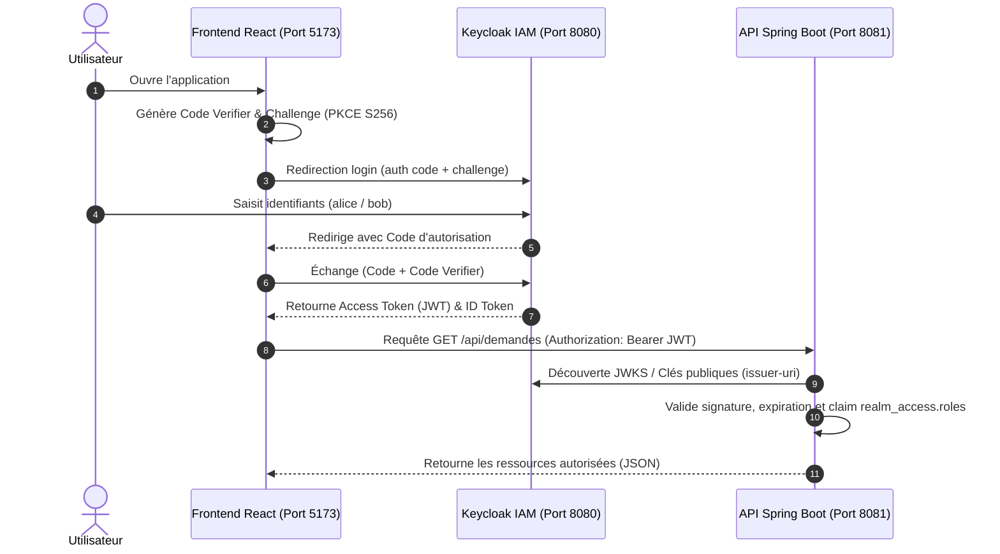
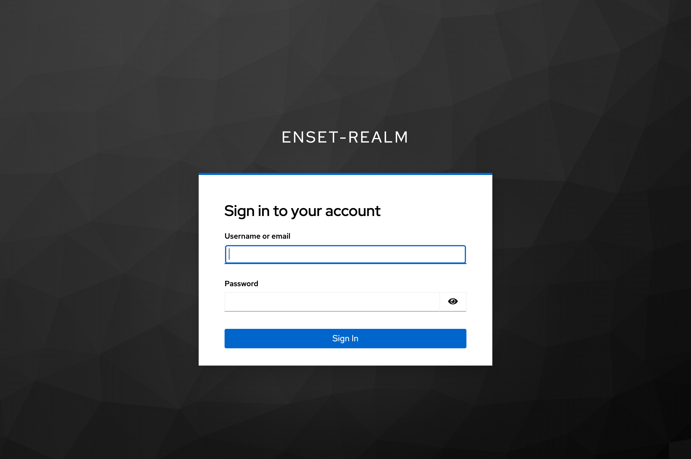
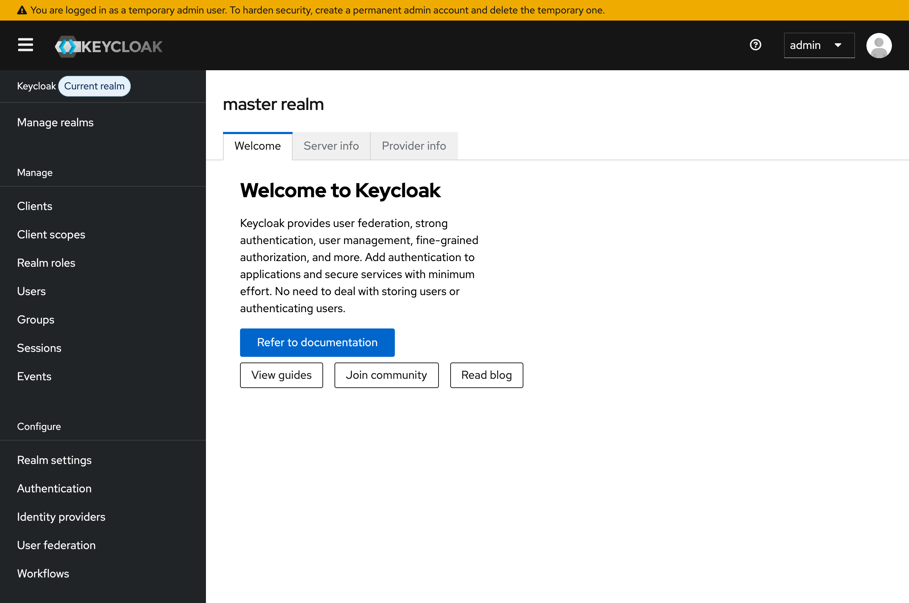
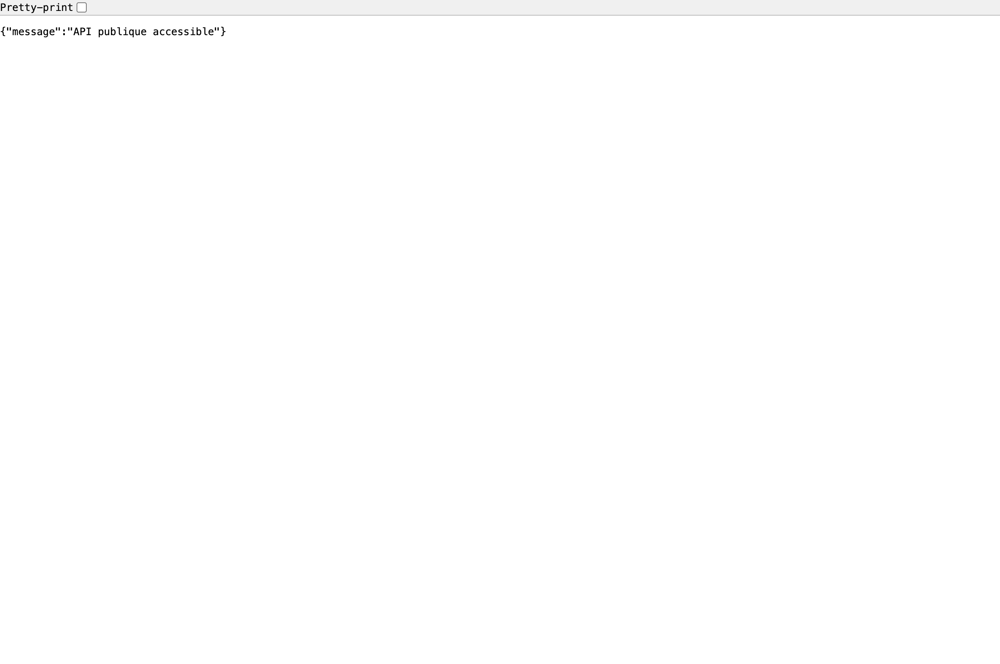
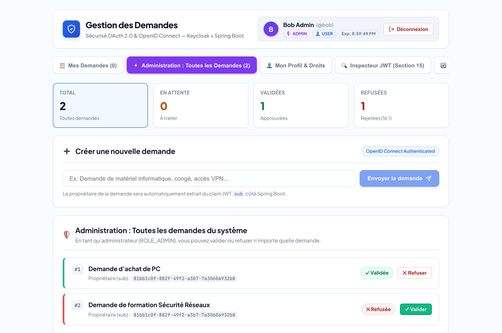
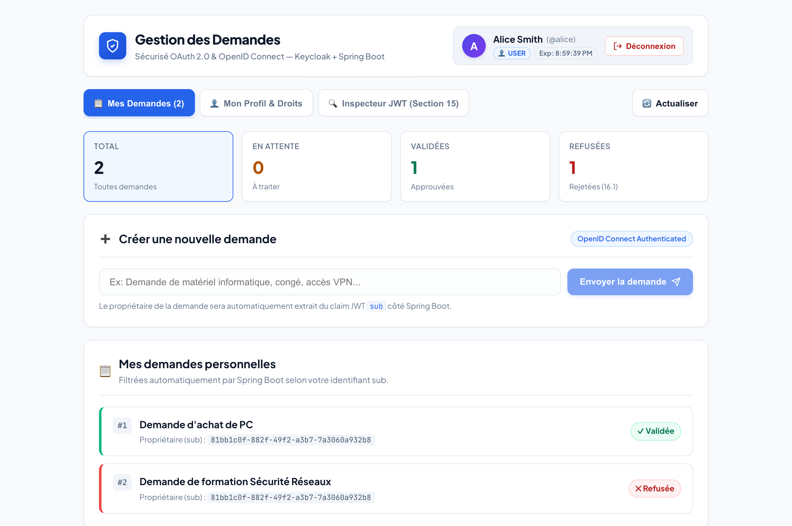
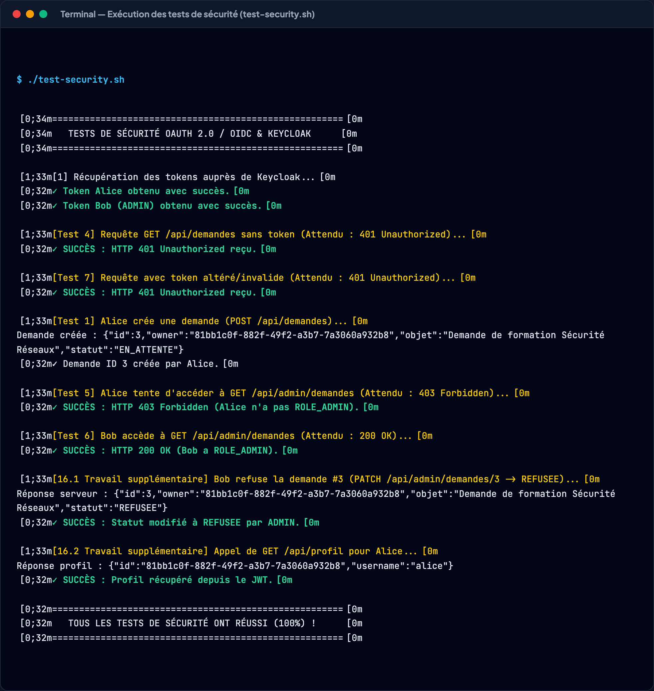
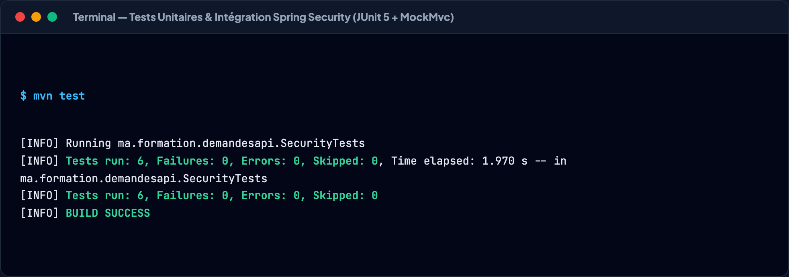

# Atelier Pratique : Sécurisation d'une Application React + Spring Boot avec Keycloak
### Module : Sécurité des Systèmes Distribués (Master SDIA / ENSET)
### Thème : OAuth 2.0 & OpenID Connect — Flux Authorization Code avec PKCE


---

## Sommaire
1. [Objectif Pédagogique & Contexte](#1-objectif-pédagogique--contexte)
2. [Rappels Théoriques](#2-rappels-théoriques)
3. [Architecture Globale & Fonctionnement](#3-architecture-globale--fonctionnement)
4. [Comptes & Droits d'Accès](#4-comptes--droits-daccès)
5. [Séance 1 : Keycloak & Spring Boot API](#5-séance-1--keycloak--spring-boot-api)
   - [5.1 Configuration de Keycloak (Docker)](#51-configuration-de-keycloak-docker)
   - [5.2 Backend Spring Boot (Resource Server)](#52-backend-spring-boot-resource-server)
   - [5.3 Mapping des Rôles & Sécurité des Endpoints](#53-mapping-des-rôles--sécurité-des-endpoints)
6. [Séance 2 : Frontend React Avancé (Light Mode)](#6-séance-2--frontend-react-avancé-light-mode)
   - [6.1 Intégration OpenID Connect & PKCE (keycloak-js)](#61-intégration-openid-connect--pkce-keycloak-js)
   - [6.2 Interface Utilisateur & Captures d'Écran](#62-interface-utilisateur--captures-décran)
   - [6.3 Inspecteur de Jeton JWT (Section 15)](#63-inspecteur-de-jeton-jwt-section-15)
7. [Travail Supplémentaire (Section 16)](#7-travail-supplémentaire-section-16)
   - [7.1 Fonctionnalité 1 : Refuser une demande (Admin)](#71-fonctionnalité-1--refuser-une-demande-admin)
   - [7.2 Fonctionnalité 2 : Endpoint /api/profil](#72-fonctionnalité-2--endpoint-apiprofil)
   - [7.3 Fonctionnalité 3 : Tests de Sécurité Automatisés](#73-fonctionnalité-3--tests-de-sécurité-automatisés)
8. [Guide d'Exécution & Démarrage](#8-guide-dexécution--démarrage)

---

## 1. Objectif Pédagogique & Contexte

L'objectif de cet atelier est de mettre en œuvre une architecture distribuée sécurisée moderne reposant sur les standards de l'industrie :
- **Serveur d'identité centralisé (IAM)** : Déploiement de **Keycloak 26**.
- **Frontend SPA (Single Page Application)** : Authentification d'une application **React 18 / Vite** via **OpenID Connect (OIDC)** et le flux **Authorization Code avec PKCE (S256)**.
- **Backend API REST** : Sécurisation de **Spring Boot 3** agissant en tant que **OAuth 2.0 Resource Server** vérifiant les jetons **Access Token (JWT)**.
- **Contrôle d'accès basé sur les rôles (RBAC)** : Application fine des autorisations selon les rôles `USER` et `ADMIN`.

---

## 2. Rappels Théoriques

| Concept | Définition & Rôle dans l'Atelier |
| :--- | :--- |
| **Authentification** | Vérifie l'identité de l'utilisateur (*« Qui êtes-vous ? »*). Assurée par Keycloak. |
| **Autorisation** | Vérifie les opérations permises (*« Quels sont vos droits ? »*). Assurée par Spring Security. |
| **OAuth 2.0** | Framework d'autorisation permettant à React d'obtenir un jeton d'accès pour l'API Spring Boot. |
| **OpenID Connect (OIDC)** | Couche d'identité construite sur OAuth 2.0 fournissant notamment l'**ID Token**. |
| **Access Token** | Jeton au format **JWT** transmis dans l'en-tête HTTP `Authorization: Bearer <token>` pour autoriser les requêtes vers l'API. |
| **ID Token** | Jeton contenant les informations de profil de l'utilisateur (nom, email, photo) pour l'affichage dans React. |
| **PKCE (Proof Key for Code Exchange)** | Mécanisme cryptographique (SHA-256) protégeant le client React public contre l'interception du code d'autorisation. |
| **Realm** | Espace logique isolé dans Keycloak (`enset-realm`) regroupant les utilisateurs, clients et rôles. |
| **Resource Server** | Le backend Spring Boot hébergeant les ressources protégées et validant la signature cryptographique des JWT. |

> **Important** : Le frontend React ne conserve aucun secret client (client public). La sécurité repose sur **PKCE** et sur la validation stricte des signatures JWT par Spring Boot via les clés publiques du Realm Keycloak.

---

## 3. Architecture Globale & Fonctionnement



### Matrice des Composants et Ports
| Composant | Technologie | Port | Description |
| :--- | :--- | :--- | :--- |
| **Identity Provider** | Keycloak 26.8.1 (Docker) | `8080` | Émission des jetons, gestion des utilisateurs et rôles |
| **Resource Server** | Spring Boot 3.3.5 / Java 21 | `8081` | Validation des JWT et protection des endpoints REST |
| **Frontend Web** | React 18 / Vite 5 | `5173` | Interface utilisateur Light Mode avec `keycloak-js` |

---

## 4. Comptes & Droits d'Accès

| Utilisateur | Mot de passe | Rôles Realm | Droits dans l'Application |
| :--- | :--- | :--- | :--- |
| **`alice`** | `alice123` | `USER` | Créer ses demandes, consulter ses propres demandes |
| **`bob`** | `bob123` | `USER`, `ADMIN` | Consulter **toutes** les demandes, Valider et Refuser (16.1) |
| **`admin`** | `admin` | Admin Master | Administration générale du serveur Keycloak |

---

## 5. Séance 1 : Keycloak & Spring Boot API

### 5.1 Configuration de Keycloak (Docker)
Le fichier `docker-compose.yml` démarre Keycloak 26 en mode développement :

```yaml
services:
  keycloak:
    image: quay.io/keycloak/keycloak:26.8.1
    container_name: keycloak-atelier
    command: start-dev
    environment:
      KC_BOOTSTRAP_ADMIN_USERNAME: admin
      KC_BOOTSTRAP_ADMIN_PASSWORD: admin
    ports:
      - "127.0.0.1:8080:8080"
    volumes:
      - keycloak_data:/opt/keycloak/data
volumes:
  keycloak_data:
```

#### Éléments configurés dans `enset-realm` :
1. **Client OpenID Connect** : `react-client`
   - Client Authentication : **Off** (Client public)
   - Standard flow : **On** (Authorization Code)
   - PKCE Code Challenge Method : **S256**
   - Valid redirect URIs : `http://localhost:5173/*`
   - Web origins : `http://localhost:5173`
2. **Rôles Realm** : `USER`, `ADMIN`
3. **Utilisateurs créés** : `alice` (USER) et `bob` (USER, ADMIN) avec mots de passe permanents.


*Figure 1 : Mire de connexion OpenID Connect Keycloak générée lors de la redirection depuis React.*


*Figure 2 : Console d'administration Keycloak (Port 8080) affichant le Realm enset-realm et ses clients.*

---

### 5.2 Backend Spring Boot (Resource Server)

Le fichier `application.properties` spécifie l'émetteur de jetons :
```properties
server.port=8081
spring.security.oauth2.resourceserver.jwt.issuer-uri=http://localhost:8080/realms/enset-realm
```

Spring Security télécharge automatiquement les clés publiques (JWKS) via l'endpoint de découverte OpenID Connect :
`http://localhost:8080/realms/enset-realm/.well-known/openid-configuration`

### 5.3 Mapping des Rôles & Sécurité des Endpoints

Dans `SecurityConfig.java`, les rôles Keycloak situés dans `realm_access.roles` sont convertis en `SimpleGrantedAuthority` avec le préfixe `ROLE_` :

```java
@Bean
JwtAuthenticationConverter jwtConverter() {
    JwtGrantedAuthoritiesConverter scopes = new JwtGrantedAuthoritiesConverter();
    JwtAuthenticationConverter converter = new JwtAuthenticationConverter();
    converter.setJwtGrantedAuthoritiesConverter(jwt -> {
        Collection<GrantedAuthority> result = new ArrayList<>(scopes.convert(jwt));
        Map<String, Object> access = jwt.getClaimAsMap("realm_access");
        if (access != null && access.get("roles") instanceof List<?> roles) {
            for (Object role : roles) {
                result.add(new SimpleGrantedAuthority("ROLE_" + role));
            }
        }
        return result;
    });
    return converter;
}
```

#### Règles d'Autorisation HTTP :
```java
.authorizeHttpRequests(auth -> auth
    .requestMatchers(HttpMethod.OPTIONS, "/**").permitAll()
    .requestMatchers(HttpMethod.GET, "/api/public").permitAll()
    .requestMatchers("/api/admin/**").hasRole("ADMIN")
    .requestMatchers("/api/demandes/**").hasAnyRole("USER", "ADMIN")
    .requestMatchers("/api/profil").authenticated()
    .anyRequest().authenticated()
)
```

#### Extraction Sécurisée du Sujet (`sub`) :
Dans `DemandeController.java`, l'identifiant du propriétaire est extrait directement du jeton sans faire confiance au corps envoyé par le client :
```java
@GetMapping("/api/demandes")
public List<Demande> mesDemandes(@AuthenticationPrincipal Jwt jwt) {
    return demandes.stream()
        .filter(d -> d.owner().equals(jwt.getSubject()))
        .toList();
}
```


*Figure 3 : Test de l'endpoint public http://localhost:8081/api/public retournant HTTP 200 sans authentification.*

---

## 6. Séance 2 : Frontend React Avancé (Light Mode)

### 6.1 Intégration OpenID Connect & PKCE (`keycloak-js`)

Le client `keycloak-js` initialise le protocole avec `pkceMethod: 'S256'` dans `main.jsx` :
```javascript
keycloak.init({
  onLoad: 'login-required',
  pkceMethod: 'S256',
  checkLoginIframe: false
}).then(() => {
  ReactDOM.createRoot(document.getElementById('root')).render(
    <React.StrictMode><App /></React.StrictMode>
  );
});
```

Dans `api.js`, le jeton est renouvelé automatiquement s'il expire dans les 30 secondes :
```javascript
export async function appelerApi(path, options = {}) {
  await keycloak.updateToken(30);
  const response = await fetch('http://localhost:8081' + path, {
    ...options,
    headers: {
      'Content-Type': 'application/json',
      Authorization: `Bearer ${keycloak.token}`,
      ...options.headers
    }
  });
  if (!response.ok) throw new Error(`HTTP ${response.status}`);
  return response.json();
}
```

---

### 6.2 Interface Utilisateur & Captures d'Écran

L'interface a été conçue selon un **Light Mode moderne et épuré** avec des cartes d'élévation, un header d'identité complet et des indicateurs d'état colorés.

#### Vue Utilisateur : `alice` (Rôle USER)
Connectée avec le rôle `USER`, Alice peut :
- Consulter ses demandes personnelles.
- Créer de nouvelles demandes (statut `EN_ATTENTE`).
- Le panneau d'administration lui est invisible.


*Figure 4 : Tableau de bord utilisateur connecté en tant que Alice (USER), affichant ses demandes et le formulaire.*

---

#### Vue Administrateur : `bob` (Rôles USER & ADMIN)
Connecté avec les rôles `USER` et `ADMIN`, Bob dispose :
- Du badge violet `🛡️ ADMIN`.
- De l'accès à l'onglet **Administration : Toutes les demandes**.
- Des boutons d'action **Valider** (vert) et **Refuser** (rouge, Section 16.1).


*Figure 5 : Espace administrateur connecté en tant que Bob (ADMIN) avec boutons Valider et Refuser.*

---

### 6.3 Inspecteur de Jeton JWT (Section 15)

L'onglet **Inspecteur JWT** permet aux étudiants et examinateurs de visualiser les claims décodés du jeton actif :
- `sub` : Identifiant unique de l'utilisateur.
- `iss` : Adresse de l'émetteur (`http://localhost:8080/realms/enset-realm`).
- `realm_access.roles` : Rôles accordés (`USER`, `ADMIN`).
- `exp` / `iat` : Dates d'émission et d'expiration.
- Bouton de copie du jeton brut dans le presse-papier pour test dans Postman ou jwt.io.


*Figure 6 : Inspecteur JWT décodant en direct les claims OpenID Connect du jeton actif.*

---

## 7. Travail Supplémentaire (Section 16)

### 7.1 Fonctionnalité 1 : Refuser une demande (Admin)
- Ajout de l'action **Refuser** dans l'interface administrateur.
- Déclenche un appel `PATCH /api/admin/demandes/{id}` avec `{ "statut": "REFUSEE" }`.
- L'API Spring Boot valide que seul un utilisateur possédant `ROLE_ADMIN` peut modifier ce statut.

### 7.2 Fonctionnalité 2 : Endpoint `/api/profil`
- Implémentation du endpoint `GET /api/profil` dans `DemandeController.java`.
- Retourne l'identifiant unique `sub` et le nom `preferred_username` extraits du JWT :
```json
{
  "id": "81bb1c0f-882f-49f2-a3b7-7a3060a932b8",
  "username": "alice"
}
```


*Figure 7 : Onglet Profil affichant les attributs d'identité OIDC et la réponse de l'API /api/profil.*

---

### 7.3 Fonctionnalité 3 : Tests de Sécurité Automatisés

Un script complet [`test-security.sh`](atelier-oauth2/test-security.sh) exécute l'intégralité des scénarios de test demandés par le professeur :

| Test | Action Exécutée | Résultat Attendu | Résultat Obtenu |
| :--- | :--- | :--- | :--- |
| **Test 1** | Alice crée une demande | HTTP 200 (EN_ATTENTE) | **200 OK** |
| **Test 2** | Bob consulte les demandes admin | HTTP 200 | **200 OK** |
| **Test 3** | Transmission `Authorization: Bearer <token>` | Requête acceptée | **Validé** |
| **Test 4** | Requête sans Access Token sur `/api/demandes` | HTTP 401 Unauthorized | **401 Unauthorized** |
| **Test 5** | Alice tente d'accéder à `/api/admin/demandes` | HTTP 403 Forbidden | **403 Forbidden** |
| **Test 6** | Bob accède à `/api/admin/demandes` | HTTP 200 OK | **200 OK** |
| **Test 7** | Jeton falsifié / altéré | HTTP 401 Unauthorized | **401 Unauthorized** |
| **16.1** | Bob refuse la demande (statut REFUSEE) | HTTP 200 (REFUSEE) | **200 OK** |
| **16.2** | Appel `GET /api/profil` pour Alice | Données JWT conformes | **200 OK** |


*Figure 8 : Exécution du script automatisé test-security.sh validant 100% des tests de sécurité.*

#### Tests d'Intégration Spring Security (JUnit 5 + MockMvc) :
6 tests automatisés couvrent les règles de sécurité au niveau du code Java :
```bash
cd atelier-oauth2/demandes-api
mvn test
```

*Figure 9 : Rapport d'exécution des 6 tests unitaires et d'intégration Spring Security (BUILD SUCCESS).*

---

## 8. Guide d'Exécution & Démarrage

### Prérequis
- Docker Desktop
- Java 17 ou 21
- Node.js (v18+) et npm

### Démarrage des Services

#### 1. Démarrer Keycloak
```bash
cd atelier-oauth2
docker compose up -d
# Optionnel : réappliquer la configuration si conteneur vierge
./setup-keycloak.sh
```
Console disponible sur : [http://localhost:8080](http://localhost:8080) (`admin` / `admin`).

#### 2. Démarrer l'API Spring Boot
```bash
cd atelier-oauth2/demandes-api
mvn clean package -DskipTests
java -jar target/demandes-api-0.0.1-SNAPSHOT.jar
```
API disponible sur : [http://localhost:8081](http://localhost:8081).

#### 3. Démarrer le Frontend React
```bash
cd atelier-oauth2/demandes-front
npm install
npm run dev
```
Application accessible sur : [http://localhost:5173](http://localhost:5173).

#### 4. Lancer la Suite de Tests de Sécurité
```bash
cd atelier-oauth2
./test-security.sh
```

---

## 9. Synthèse Pédagogique

Cet atelier met en évidence la complémentarité des rôles :
1. **Keycloak** centralise la gestion des utilisateurs, l'authentification et le cycle de vie des jetons.
2. **React** ne manipule que des jetons temporaires en mémoire, sécurisés par **PKCE**, sans jamais connaître les mots de passe.
3. **Spring Boot** agit en tant que serveur de ressources indépendant : il ne contacte Keycloak que pour vérifier les signatures cryptographiques et applique le principe du moindre privilège (*Least Privilege*) sur chaque endpoint REST.
